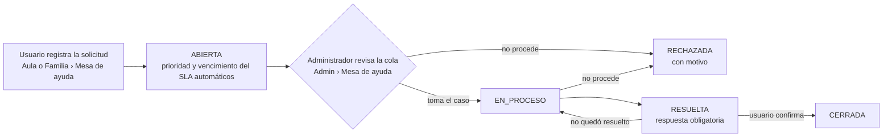

# 9. Gestión de solicitudes de servicio (APF3)

Práctica de **gestión de solicitudes de servicio** de ITIL 4 y requisito 8.6 de ISO/IEC 20000-1
(*solicitudes de servicio*). Una solicitud es un pedido normal del usuario que no es una falla
(información, acceso, cambio de turno); las fallas se tratan como incidentes (ver informe APF2, §6.3).

## 9.1 Catálogo de solicitudes

El catálogo está definido en el código (`TipoSolicitud.java`) y se publica en `GET /api/public/catalogo-servicios`,
de modo que la plataforma, la documentación y el SLA usan la misma fuente.

| Tipo | Quién lo pide | Prioridad | SLA de resolución | Atención |
|------|---------------|-----------|-------------------|----------|
| Solicitud de información | Alumno, apoderado | Baja | 24 h | Responder la consulta (precios, horarios, pagos) |
| Acceso a la cuenta o a una clase | Alumno, apoderado | Alta | 8 h | Revisar matrícula y vigencia; activar o corregir |
| Restablecer contraseña | Alumno, apoderado | Alta | 4 h | Contraseña temporal desde *Admin › Usuarios* (cambio obligatorio) |
| Cambio de turno u horario | Alumno | Media | 48 h | Verificar cupo y actualizar la matrícula |
| Vincular a mi hijo o hija | Apoderado | Media | 48 h | Verificar el parentesco y crear el vínculo en *Admin › Familias* |
| Soporte técnico | Alumno, apoderado | Alta | 8 h | Diagnóstico; si es una falla del sistema se abre un incidente |

Además siguen vigentes las **solicitudes de información de visitantes** (clase de diagnóstico gratuita, formulario público
de la página principal, *Admin › Solicitudes*) y las **solicitudes internas** del equipo en GitHub
(plantilla *Solicitud de servicio interna*).

## 9.2 Procedimiento de atención

1. **Registro**: el alumno o apoderado elige el tipo en el catálogo, escribe asunto y detalle. El sistema asigna código
   (`SR-00001`), prioridad y fecha de vencimiento (creación + horas del SLA). Se valida la entrada (sin HTML, longitudes)
   y un máximo de 5 solicitudes pendientes por usuario.
2. **Clasificación y priorización**: la cola del administrador se ordena por pendientes, prioridad y vencimiento.
   Las solicitudes con menos del 25 % del plazo restante se marcan *Por vencer* y aparecen en *Requiere tu atención*.
3. **Atención**: el administrador pasa la solicitud a *En proceso* y ejecuta el procedimiento del tipo (tabla 9.1).
4. **Resolución**: al resolver o rechazar se exige una respuesta para el usuario; queda la fecha de resolución.
5. **Cierre**: el usuario confirma que quedó resuelto (CERRADA). Si no, el administrador puede reabrirla (EN_PROCESO).
6. **Seguimiento**: cada creación y cambio de estado se registra en la auditoría (`SOLICITUD_CREADA`, `SOLICITUD_ACTUALIZADA`).
   Los indicadores se revisan en la revisión mensual del servicio.

## 9.3 Herramientas

| Herramienta | Uso |
|-------------|-----|
| Mesa de ayuda de la plataforma | Registro y seguimiento por el usuario; cola, SLA, indicadores y exportación CSV para el administrador |
| Auditoría de la plataforma | Trazabilidad de quién creó y atendió cada solicitud |
| GitHub Issues | Solicitudes internas del equipo e incidentes (plantillas en `.github/ISSUE_TEMPLATE/`) |
| WhatsApp Business | Canal de contacto complementario (no reemplaza el registro) |

## 9.4 Indicadores

| Indicador | Meta | Fuente |
|-----------|------|--------|
| Cumplimiento del SLA | ≥ 90 % de solicitudes atendidas dentro del plazo | `GET /api/admin/mesa-ayuda/metricas` |
| Tiempo medio de resolución | ≤ 8 h | Misma fuente |
| Solicitudes vencidas pendientes | 0 | Tarjeta *Por vencer o vencidas* |

## 9.5 Seguridad

- `/api/mesa-ayuda/**` solo para ALUMNO y APODERADO (regla por URL y `@PreAuthorize`); el panel solo para ADMIN.
- Un usuario no ve ni cierra solicitudes ajenas: la respuesta es 404, igual que si no existiera (protección IDOR).
- Límite de 5 registros por minuto y por IP (429) y anotación `@SinHtml` en asunto, detalle y respuesta.
- Pruebas: MDA-01…10, SLA-01…05 (back-end) y MDA-F01…F07 (front-end).
