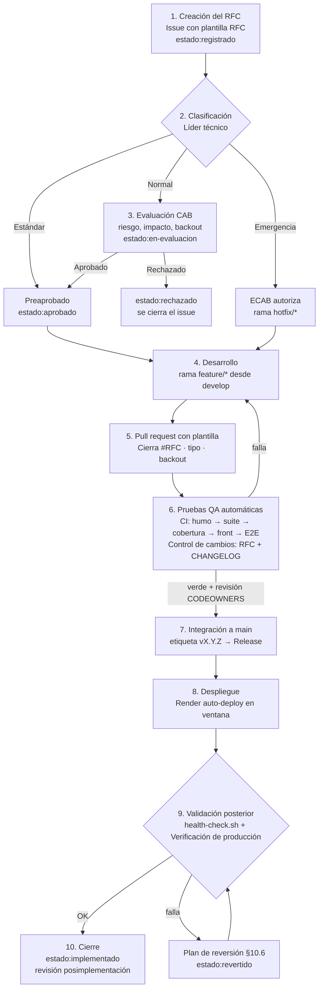

# 10. Gestión del cambio (APF3)

Procedimiento formal de **control de cambios** de Matemática Sin Estrés según la práctica *habilitación de cambios*
(change enablement) de ITIL 4 y el requisito 8.5.1 de ISO/IEC 20000-1 (*gestión del cambio*).
Cubre cuatro objetos de cambio: **infraestructura** (Render, Docker, CI/CD), **aplicaciones** (front-end, API y base de datos),
**documentación** (docs/, informes, manuales) y **calendario** (cronograma de sprints e hitos APF).

Ninguna modificación llega a producción sin un **RFC** (Request for Change) registrado como issue de GitHub,
un **pull request** que lo referencia, el **CI en verde** y la aprobación correspondiente a su tipo.

## 10.1 Roles

| Rol | Responsable | Funciones |
|-----|-------------|-----------|
| Solicitante | Cualquier integrante, la academia o el docente (por observaciones) | Registra el RFC con justificación e impacto |
| Gestor del cambio / Líder técnico | Bryan Díaz | Evalúa el RFC, clasifica el tipo y el riesgo, revisa el PR (CODEOWNERS) |
| Comité de Cambios (CAB) | Líder técnico + representante de la academia (dirección académica) + QA | Aprueba o rechaza los cambios normales; revisa el calendario de cambios |
| CAB de emergencia (ECAB) | Gerente de TI / DevOps Lead (Bryan Díaz) | Autoriza cambios de emergencia sin esperar al CAB |
| QA | Responsable de pruebas del sprint | Ejecuta las pruebas y adjunta la evidencia al PR |
| DevOps Lead / SysAdmin | Bryan Díaz | Despliega, valida en producción y ejecuta el plan de reversión |

> El equipo es pequeño, por eso una persona cumple varios roles. Para mantener la separación de funciones, el representante
> de la academia aprueba en el CAB todo cambio normal que afecte a usuarios, datos o cronograma.

## 10.2 Flujo del RFC en GitHub (Paso 1 del taller)

| Fase del flujo RFC | Responsable de la ejecución | Herramienta utilizada | Evidencia o registro generado |
|--------------------|-----------------------------|-----------------------|-------------------------------|
| 1. Creación del RFC | Solicitante / Líder técnico | GitHub Issues (plantillas `.github/ISSUE_TEMPLATE/01…03`) | Issue RFC con componente, justificación, impacto, riesgo, pruebas y backout |
| 2. Clasificación | Líder técnico | Etiquetas de GitHub (`cambio-*`, `riesgo:*`) y GitHub Projects | Tipo y riesgo del cambio en el issue; tarjeta en el tablero del sprint |
| 3. Evaluación CAB | Comité de Cambios (CAB) | Comentario de aprobación en el issue + etiqueta `estado:aprobado` | Acta digital: comentario con fecha, aprobadores y condiciones |
| 4. Desarrollo | Desarrollador | Git (ramas `feature/*`, `hotfix/*`), VS Code / IntelliJ | Commits convencionales vinculados al RFC |
| 5. Pull request | Desarrollador | Plantilla `.github/pull_request_template.md`, CODEOWNERS | PR con RFC, tipo, componentes, pruebas y backout |
| 6. Pruebas QA | QA / DevOps | GitHub Actions (`ci.yml`, `control-cambios.yml`), JUnit 5, MockMvc, Playwright, Postman | Reporte de pruebas, cobertura JaCoCo y resumen de control de cambios en el PR |
| 7. Integración y release | Líder técnico | Rama protegida `main`, etiqueta semántica, `release.yml` | Merge aprobado, release de GitHub con notas desde CHANGELOG.md |
| 8. Despliegue | DevOps Lead | Render (Blueprint `render.yaml`, Docker) | Log de despliegue de Render con el commit desplegado |
| 9. Validación posterior | DevOps Lead | `scripts/health-check.sh`, `verificacion-produccion.yml`, `/api/public/version` | Salida del health check y versión desplegada; issue de incidente si falla |
| 10. Cierre | Gestor del cambio | Issue RFC (`estado:implementado`) | Revisión posimplementación en el issue y entrada en el registro de RFC |

## 10.3 Matriz de tipos de cambio, riesgo y aprobación (Paso 2 del taller)

| Tipo de cambio | Ejemplo concreto en el proyecto | Nivel de riesgo | Rol aprobador autorizado | Mecanismo de control / auditoría |
|----------------|---------------------------------|-----------------|--------------------------|----------------------------------|
| **Estándar** | PR de Dependabot que actualiza una dependencia menor (p. ej. `lucide-react` o `jjwt` de parche); publicar u ocultar una clase grabada desde el panel | Bajo | Preaprobado: Líder técnico / automático | CI de GitHub Actions en verde; el workflow *Control de cambios* lo reconoce como estándar; auditoría del panel |
| **Normal** | Migración Flyway **V6** que crea `solicitudes_servicio` y el módulo de mesa de ayuda (RFC-2026-001); cambio de plan en Render; mover un hito del cronograma | Medio / Alto | Comité de Cambios (CAB) | RFC aprobado (`estado:aprobado`), PR revisado por CODEOWNERS, respaldo de BD previo, validación en entorno local con PostgreSQL (`docker compose`) y health check posterior |
| **Emergencia** | Parche urgente de una vulnerabilidad crítica (CVE) en Spring Security o jjwt; reversión inmediata porque la API responde 5xx tras un despliegue | Crítico | Gerente de TI / DevOps Lead (ECAB) | Issue RFC-EMG enlazado al incidente P1, rama `hotfix/*`, `scripts/rollback.sh`, verificación inmediata y revisión posimplementación en 48 h |

**Catálogo de cambios estándar preaprobados:** actualizaciones menores y de parche de dependencias; alta, edición
u ocultamiento de clases grabadas; ajustes de textos, precios u horarios en datos del catálogo; corrección de documentación
sin cambio de alcance; rotación programada de secretos.

### Evaluación del riesgo

Riesgo = probabilidad (1–3) × impacto (1–3), con la misma escala de la matriz de riesgos del APF1.

| Criterio de impacto | 1 · Bajo | 2 · Medio | 3 · Alto |
|---------------------|----------|-----------|----------|
| Usuarios afectados | Ninguno o solo el administrador | Un nivel o un grupo | Todos |
| Datos | Sin cambios | Datos nuevos (agrega) | Modifica o elimina datos existentes |
| Disponibilidad | Sin corte | Corte < 5 min en la ventana | Corte fuera de la ventana |

Bajo (1–2) → estándar o normal simplificado · Medio (3–4) → CAB · Alto (6–9) → CAB con respaldo obligatorio y prueba del backout.

## 10.4 Calendario de cambios y ventana de mantenimiento

- **Ventana de mantenimiento:** domingos de 23:00 a 01:00 (hora de Lima), avisada con 48 horas (compromiso del SLA).
- **Congelamiento:** no se despliegan cambios normales 48 horas antes de cada entrega (APF3, semana 13; entrega final, semana 16)
  ni en horario de clases en vivo (lunes a viernes, 08:00–21:00); solo cambios de emergencia.
- **Cambios del calendario del proyecto:** mover un hito, un sprint o el alcance es un RFC normal con componente
  *Cronograma / alcance*; lo aprueban el CAB y, si afecta una entrega, el docente.

| Fecha | RFC | Cambio | Tipo | Estado |
|-------|-----|--------|------|--------|
| 2026-10-25 23:00 | RFC-2026-001 | Mesa de ayuda + migración V6 | Normal | Aprobado, programado |
| 2026-10-25 23:00 | RFC-2026-002 | Endpoint de versión | Normal (riesgo bajo) | Aprobado, programado |
| 2026-10-25 | RFC-2026-003 | Plantillas y workflows de control de cambios | Normal (riesgo bajo) | Aprobado |
| 2026-10-25 | RFC-2026-004 | Prueba de carga y plan de capacidad | Estándar (documentación y script) | Aprobado |

## 10.5 Control de la documentación

La documentación vive en el repositorio (`docs/`, `README.md`, `CHANGELOG.md`), por lo que sigue el mismo flujo:
toda modificación entra por PR, queda versionada y se publica con la release. Los informes de avance (Word y PPT)
se versionan por entrega (APF1, APF2, APF3) y se referencian en la release correspondiente.

## 10.6 Plan de reversión (Backout Plan · Paso 3 del taller)

**1. Condiciones de activación** (cualquiera de ellas, dentro de la ventana o hasta 2 horas después del despliegue):

- La migración Flyway falla y la API no arranca (Render muestra el despliegue como *failed* o el health check no responde UP en 5 minutos).
- Errores 5xx en la API principal (`/api/auth/login`, `/api/alumno/**`, `/api/admin/**`) en más del 1 % de las peticiones,
  o `scripts/health-check.sh` devuelve alguna falla.
- La versión de `/api/public/version` no coincide con la release o una funcionalidad crítica (login, aula, matrículas) deja de operar.
- Tiempo de respuesta p95 mayor a 2 s de forma sostenida (incumple el SLA).

**2. Procedimiento técnico de reversión (rollback):**

| Paso | Acción | Comando / herramienta |
|------|--------|-----------------------|
| 1 | Detener el servicio afectado o el tráfico al despliegue fallido | Render › mse-backend › *Rollback* al despliegue anterior (deja de servir el nuevo). Local: `docker compose down` |
| 2 | Restaurar la versión estable anterior desde la etiqueta de Git | `scripts/rollback.sh v1.5.0` (rama `hotfix/rollback-v1.5.0` con el árbol de la etiqueta) → PR de emergencia → merge a `main` (Render redespliega). Local: `git checkout tags/v1.5.0 && docker compose up --build -d` |
| 2b | Solo si el cambio modificó datos: restaurar el respaldo tomado antes del cambio | `DATABASE_URL=... scripts/respaldo-bd.sh restaurar respaldos/mse-AAAAMMDD-HHMM.dump` |
| 3 | Ejecutar pruebas rápidas de sanidad (health check) | `scripts/health-check.sh https://mse-backend.onrender.com 1.5.0` y prueba manual de login de alumno y administrador |
| 4 | Comunicar y registrar | Etiqueta `estado:revertido` en el RFC, issue de incidente con la causa y aviso por WhatsApp a la academia |

**Por qué la base de datos casi nunca se restaura:** las migraciones siguen el patrón *expand / contract*. Una versión solo
**agrega** tablas o columnas (V6 crea `solicitudes_servicio` y no toca otras), por lo que la versión anterior funciona sobre
el esquema nuevo. Borrar columnas o tablas se hace en una release posterior, cuando ya no existe ninguna versión que las use.
El workflow *Control de cambios* advierte cuando una migración contiene `DROP` o `TRUNCATE`.

**3. Responsable de la ejecución del backout:** Bryan Santiago Díaz Dávila, DevOps Lead (respaldo: Líder técnico).

**4. Tiempo máximo estimado de recuperación (RTO): 15 minutos** para la reversión de la aplicación
(rollback en Render ≈ 3–5 min, verificación ≈ 2–5 min). Si se debe restaurar la base de datos, el RTO es de 60 minutos,
dentro del RTO de 4 horas comprometido en el SLA.

## 10.7 Integración continua y buenas prácticas

| Práctica | Implementación |
|----------|----------------|
| Integración continua | `ci.yml`: pruebas de humo → suite completa del back-end (139 pruebas) con cobertura JaCoCo → front-end (74 pruebas + build) → E2E Playwright, en cada push y PR |
| Control de cambios automatizado | `control-cambios.yml`: exige RFC (`Cierra #n`), tipo de cambio, CHANGELOG actualizado y `hotfix/*` en emergencias; advierte migraciones destructivas |
| Entrega versionada | `release.yml`: con cada etiqueta `vX.Y.Z` verifica que coincida con el pom, vuelve a probar y publica la release con las notas del CHANGELOG |
| Validación en producción | `verificacion-produccion.yml`: health check cada 30 min en horario de servicio y al publicar una release; abre un incidente si falla |
| Revisión obligatoria | Rama `main` protegida + CODEOWNERS (ver configuración abajo) |
| Cadena de suministro | Dependabot semanal (Maven, npm, Actions) como cambios estándar |
| Infraestructura como código | `render.yaml`, `Dockerfile`, `docker-compose.yml` versionados |
| Secretos fuera del código | `JWT_SECRET` y credenciales de BD como variables de entorno de Render |

**Configuración de la protección de `main`** (GitHub › Settings › Branches › Add rule): *Require a pull request before merging*
(1 aprobación, *Require review from Code Owners*), *Require status checks to pass* (`Pruebas de humo`, `Back-end (suite completa + cobertura)`,
`Front-end (pruebas unitarias + build)`, `RFC y registro de cambios`) y *Do not allow bypassing the above settings*.
Las etiquetas del flujo se crean con `scripts/crear-etiquetas.sh`.

## 10.8 Revisión posimplementación

En los dos días siguientes a cada cambio normal o de emergencia, el gestor del cambio comenta en el RFC:
¿se cumplió el objetivo?, ¿hubo incidentes?, ¿se usó el backout?, lecciones aprendidas. El registro de cambios del proyecto
está en [docs/rfc/registro.md](rfc/registro.md).
