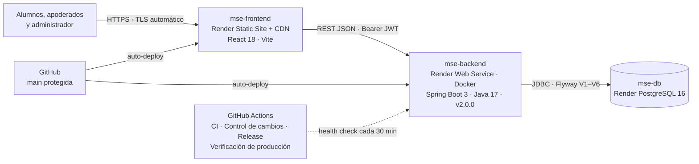

# 12. Despliegue de la versión final (APF3)

## 12.1 Arquitectura de despliegue

| Componente | Servicio | Configuración relevante |
|------------|----------|-------------------------|
| mse-frontend | Render Static Site | `npm ci && npm run build`, reescritura a `index.html`, cabeceras `X-Frame-Options`, `nosniff`, `Referrer-Policy` |
| mse-backend | Render Web Service (Docker) | Perfil `prod`, health check `/api/public/health`, usuario sin privilegios, apagado ordenado, `RENDER_GIT_COMMIT` en `/api/public/version` |
| mse-db | Render PostgreSQL 16 | Credenciales como variables de entorno; Flyway aplica V1–V6 al arrancar |
| Dominio y certificados | `*.onrender.com` con TLS administrado por Render (Let's Encrypt); HSTS desde la API | Dominio propio opcional: CNAME a Render y certificado automático |

## 12.2 Procedimiento de despliegue de la v2.0.0

1. RFC-2026-001…004 aprobados; respaldo de la BD: `scripts/respaldo-bd.sh respaldar`.
2. PR de `develop` a `main` con CI y *Control de cambios* en verde; revisión de CODEOWNERS.
3. Merge en la ventana (domingo 23:00) → Render despliega el back-end y el front-end automáticamente.
4. Etiqueta: `git tag -a v2.0.0 -m "Versión final APF3" && git push origin v2.0.0` → el workflow *Release* publica la release.
5. Validación: `scripts/health-check.sh https://mse-backend.onrender.com 2.0.0` y prueba manual de los flujos críticos.
6. Si falla: plan de reversión (docs/10, §10.6).

## 12.3 Evidencias de producción (lista de verificación)

- [ ] `GET /api/public/health` responde `{"estado":"UP","version":"2.0.0"}`
- [ ] `GET /api/public/version` muestra `2.0.0` y el commit desplegado
- [ ] La web carga niveles, precios y el catálogo de servicios desde la BD
- [ ] El alumno registra una solicitud en *Mesa de ayuda* y el administrador la resuelve
- [ ] Ruta protegida sin token → 401; alumno en `/api/admin/**` → 403
- [ ] Candado HTTPS válido en el navegador (certificado de Render)
- [ ] Release `v2.0.0` publicada en GitHub con las notas de la versión

## 12.4 Notas de la versión 2.0.0

Ver la sección `[2.0.0]` de [CHANGELOG.md](../CHANGELOG.md). Resumen de lo que se entrega en la versión final:

| Módulo | Funcionalidad |
|--------|---------------|
| Web pública | Catálogo de niveles, precios y horarios desde la BD; clase de diagnóstico; asistente de preguntas frecuentes |
| Cuentas y seguridad | Registro de alumno o apoderado, JWT, BCrypt, bloqueo por intentos, límite por IP, contraseña temporal, auditoría |
| Aula del alumno | Clases por nivel con matrícula activa, progreso, favoritas, horarios con recordatorio `.ics`, matrículas |
| Portal de padres | Hijos vinculados, informe de avance imprimible y CSV |
| Mesa de ayuda (nuevo) | Catálogo de 6 servicios con SLA, seguimiento por el usuario, cola e indicadores para el administrador |
| Panel de administración | Resumen con indicadores, matrículas, clases, usuarios, familias, solicitudes, mesa de ayuda y auditoría |
| Operación (nuevo) | Endpoint de versión, control de cambios en GitHub, release automática, verificación de producción, rollback y prueba de carga |
| Calidad | 139 pruebas del back-end (cobertura 84.8 % de instrucciones), 74 del front-end y suite E2E |
